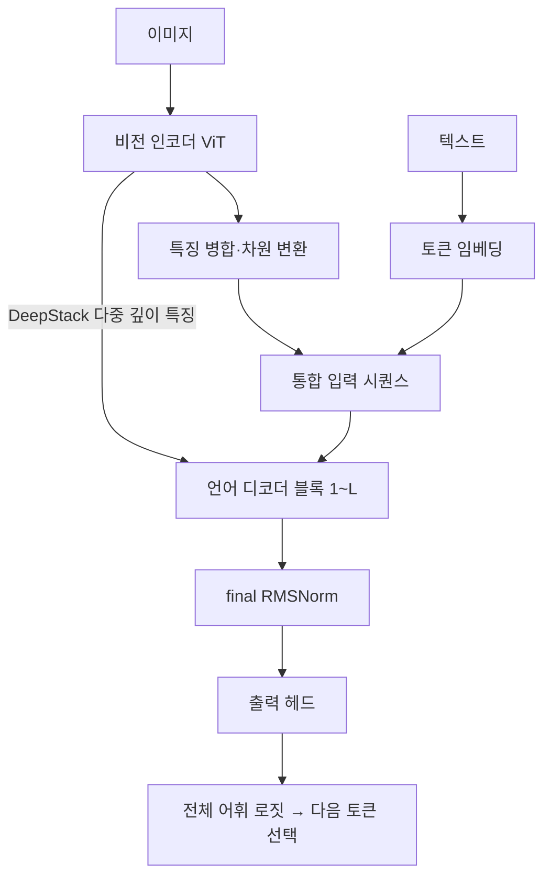

# Qwen3-VL 아키텍처와 벡터 수집 지점

기본 어댑터가 지원하는 **dense Qwen3-VL**, 특히 4B Instruct의 구조와 수집 위치를 설명합니다. 다른 모델에는 정규화·DeepStack·캐시 처리를 그대로 적용하지 마세요.

[CLI·결과 필드](GUIDE.md) · [모델 확장](ADAPTERS.md)

## 입력에서 다음 토큰까지

이미지 특징과 텍스트를 언어 디코더가 함께 처리하며, 생성한 토큰을 다음 입력으로 사용해 출력을 이어 갑니다. Qwen3-VL은 여러 깊이의 시각 특징을 언어 모델에 전달하는 DeepStack과, 시간·높이·너비 위치 정보를 다루는 Interleaved-MRoPE를 사용합니다. [공식 Qwen3-VL 설명](https://github.com/QwenLM/Qwen3-VL#introduction)

## 기본 4B 모델의 구성

아래 값은 원본 `Qwen/Qwen3-VL-4B-Instruct`의 공식 설정 기준입니다. 다른 크기의 체크포인트에 그대로 적용하지 마세요. [공식 config.json](https://huggingface.co/Qwen/Qwen3-VL-4B-Instruct/blob/main/config.json)

| 구성 | 설정 | 의미 |
| --- | --- | --- |
| 언어 디코더 | 36개 블록 | GUIDE의 레이어 1~36에 대응 |
| 언어 히든 차원 | 2,560 | 저장 벡터 한 개의 길이 |
| 어휘 크기 | 151,936 | 출력 헤드가 점수를 매기는 토큰 수 |
| 어텐션 | Query 32개, KV 8개, head dimension 128 | 여러 Query 헤드가 KV 헤드를 공유하는 GQA 구성 |
| MLP 중간 차원 | 9,728 | 언어 블록 내부 feed-forward 차원 |
| 입력·출력 가중치 | `tie_word_embeddings=true` | 토큰 임베딩과 출력 투영 가중치를 공유 |
| 비전 인코더 | 24개 블록, 히든 차원 1,024, 헤드 16개 | 이미지의 시각 특징을 처리 |
| 이미지 패치 | 공간 패치 크기 16, spatial merge 2 | 패치 특징을 병합하여 언어 입력에 연결 |
| 비전 출력 차원 | 2,560 | 언어 디코더 차원과 연결 |
| DeepStack 특징 인덱스 | `[5, 11, 17]` | **비전 인코더의** 특징 추출 인덱스. 언어 레이어 번호와 구분 |

실제 실행의 크기·양자화 설정은 `metadata.json`에서 확인합니다. 원본 모델의 구조, 4bit 가중치 표현, 활성값 dtype은 별개의 정보입니다.

## 디코더 블록과 출력 헤드

디코더 블록은 앞선 문맥에 대한 causal self-attention과 MLP, 정규화 및 잔차 연결을 통해 표현을 갱신합니다. 각 블록의 출력은 다음 블록으로 전달되며, 최종 블록 이후 final RMSNorm과 출력 헤드가 다음 토큰 로짓을 만듭니다.

프로젝트는 MLX-VLM이 로드한 블록을 그대로 실행하고 호출을 잠시 감싸 벡터를 읽습니다. 원래 가중치나 설치된 패키지 파일을 수정하지 않습니다. 출력 헤드는 모델 설정에 따라 공유 임베딩의 선형 투영 또는 별도 `lm_head`를 사용합니다. [Qwen 출력 헤드 구현](../src/adapters/qwen3_vl.py)

## DeepStack과 실제 수집 위치

| 항목 | 수집 기준 |
| --- | --- |
| 레이어 | 각 언어 디코더 블록 출력 |
| 처리 시점 | 해당 블록의 DeepStack 추가 전·final RMSNorm 전 |
| 토큰 위치 | 다음 생성 토큰을 예측하는 마지막 텍스트 위치 |
| 제외되는 값 | 이미지 위치·비전 인코더 벡터, 입력 임베딩, final norm 이후 값 |

이 구현에서 DeepStack은 이미지 위치에 특징을 더하므로, 관찰하는 마지막 텍스트 위치는 해당 블록의 주입 직전·직후 값이 같습니다. 앞선 블록을 통해 전달된 이미지 정보는 텍스트 위치의 표현에 영향을 줄 수 있습니다. 따라서 “DeepStack 주입 전 수집”이 이미지 정보를 제외한다는 뜻은 아닙니다. [Qwen 수집 위치 정의](../src/adapters/qwen3_vl.py), [공통 블록 수집](../src/common/model.py)

기본 4B 모델에서 생성 토큰이 실제로 200개라면 저장 배열은 `[200, 36, 2560]`이며 float32 순수 배열 크기는 약 70.3 MiB입니다.

## 위치 정보와 생성 캐시

공식 모델은 Interleaved-MRoPE로 멀티모달 위치를 표현합니다. 이 프로젝트는 위치 계산을 직접 재구현하지 않고 MLX-VLM의 입력 준비와 모델 실행을 사용합니다. 첫 입력에서 이미지 임베딩을 준비한 뒤, 이후 생성은 KV 캐시와 `rope_deltas`를 유지하며 이미지 인코딩을 반복하지 않습니다. [공식 구조 설명](https://github.com/QwenLM/Qwen3-VL#introduction), [Qwen 입력·캐시 처리](../src/adapters/qwen3_vl.py)

## 이 프로젝트에서의 지원 범위

기본 Qwen 어댑터는 `qwen3_vl` 타입과 `Qwen3VLDecoderLayer` 구현을 확인합니다. dense 모델을 대상으로 하며 MoE는 지원하지 않습니다. [구조 검사 코드](../src/adapters/qwen3_vl.py)

Qwen3-VL 계열에는 Instruct·Thinking 모델이 있습니다. 기본 모델은 Instruct이며, 단계별 설명을 요청해도 Thinking 체크포인트로 바뀌지는 않습니다. [공식 모델 계열 설명](https://github.com/QwenLM/Qwen3-VL#introduction)

이 CLI는 질문 한 건·이미지 최대 한 장, 기본 입력 상한 2,048토큰으로 동작합니다. 모델 자체의 영상·다중 이미지·긴 문맥 기능과 구분하세요. 다른 모델 연결과 MLX-VLM 버전 조건은 [어댑터 가이드](ADAPTERS.md)를 참고하세요.
